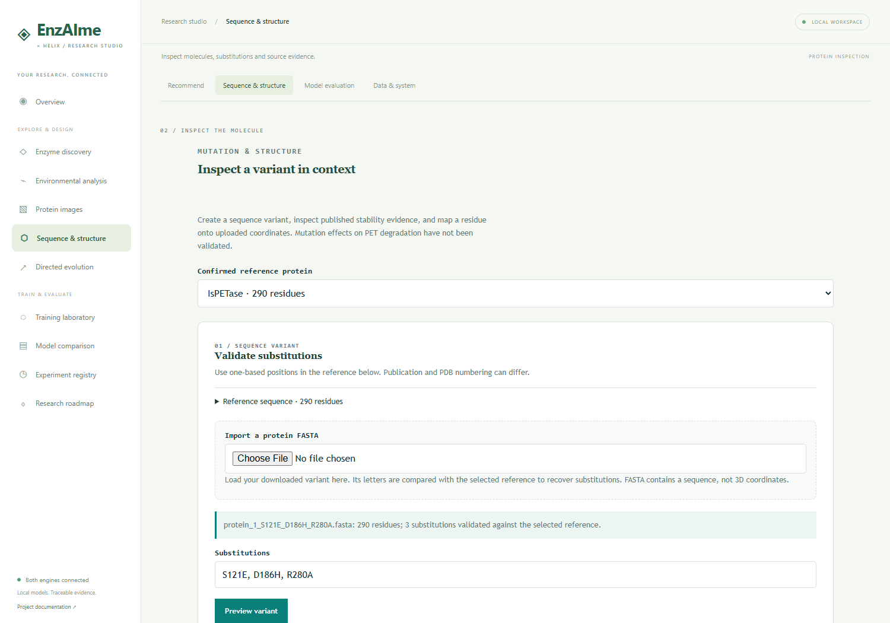
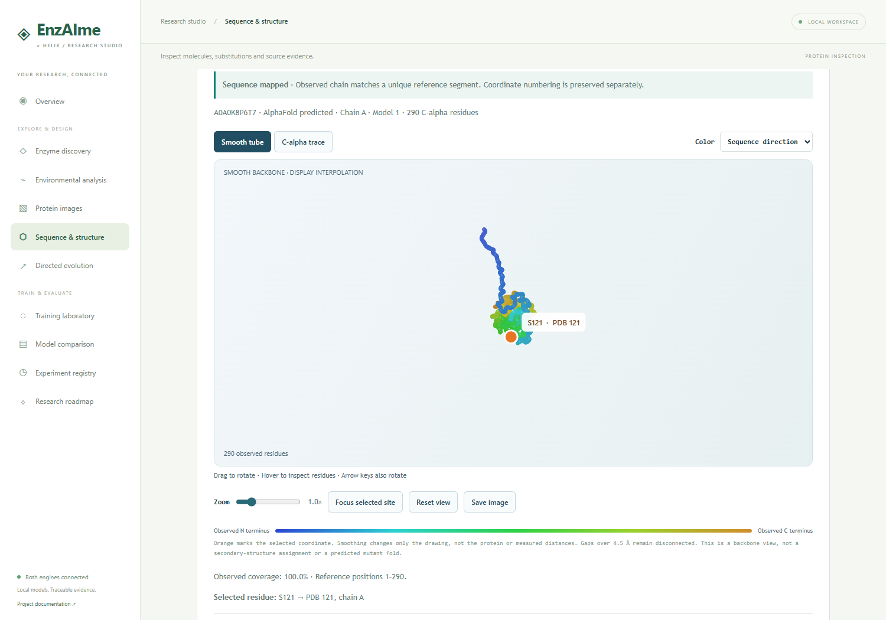

# FASTA, residues and structure inspection

The screenshot error occurred because a downloaded **sequence file** was selected in a **coordinate-file** field. The download was correct; the old interface did not connect the next step clearly enough. The integrated interface now imports FASTA separately and connects validated edits directly to reference structure inspection.

| File or image | What it contains | How to use it |
|---|---|---|
| Mutant FASTA (`.fasta`, `.fa`, `.faa`) | A header and the edited amino-acid sequence | Import a protein FASTA in Sequence & structure; use in other sequence/folding tools |
| Reference PDB (`.pdb`, `.ent`) | Existing atom coordinates for the reference | Load the catalog structure, or upload into the PDB coordinate field |
| Backbone front/side/top images | Three projections of the same existing coordinates | Visual comparison and illustration |
| Distance image | Pairwise C-alpha distances, clipped at 20 Å | Structural representation; bright pixels indicate proximity |
| Proximity image | C-alpha pairs within 8 Å | A thresholded structural representation, not an experimental contact assay |

## Reproduce the example in your screenshots

1. Start `Start-Research.cmd`, open http://127.0.0.1:8765/#structure and select the 290-residue IsPETase reference (protein 1).
2. Enter `S121E, D186H, R280A` and select **Preview variant**. Alternatively, select the downloaded `protein_1_S121E_D186H_R280A.fasta` under **Import a protein FASTA**. Both routes recover the same three edits.
3. Select **Inspect edits on reference structure**. The viewer loads the cached, sequence-matched AlphaFold reference and highlights reference residue **S121**.
4. Select **D186H** or **R280A** above the coordinate form to inspect **D186** or **R280**. Drag to rotate; use the zoom slider, arrow keys, or **Focus selected site**.
5. Select **Download reference PDB** to save `protein_1_reference_A0A0K8P6T7.pdb`. That file can be uploaded back into the PDB coordinate field and inspected at a reference sequence position.

## What the result establishes

`S121E` means replacing the serine at one-based reference sequence position 121 with glutamate in the exported sequence. It does not mean that glutamate's three-dimensional coordinates were calculated. The structure view retains the reference's serine and its existing coordinates. The same distinction applies to the other substitutions.

Sequence import validates one record, standard amino-acid letters, equal sequence length and up to 20 substitutions. Insertions/deletions need alignment and are rejected by this substitution workflow. Reference sequence numbering and PDB residue numbering can differ; the viewer displays both after mapping. Unsupported catalog proteins can lack a matching cached structure; an uploaded PDB still needs a supported sequence match before a site can be mapped.

FASTA alone cannot be rendered as a physically supported 3D structure. A separate folding workflow is needed to predict a new mutant fold, followed by quality assessment. Renaming `.fasta` to `.pdb` cannot create coordinates. This project currently provides reference inspection and image rendering, not mutant folding or experimentally established mutation effects.

## Verification

The exact three-substitution workflow passed a real-browser check, including FASTA download/reimport, all three reference positions, rotation/focus/reset and navigation persistence. The downloaded reference PDB matched the catalog text exactly. Direct FASTA uploads to the PDB field and FASTA content renamed `.pdb` receive actionable errors. See `reports/sequence_workflow_verification.json`.
