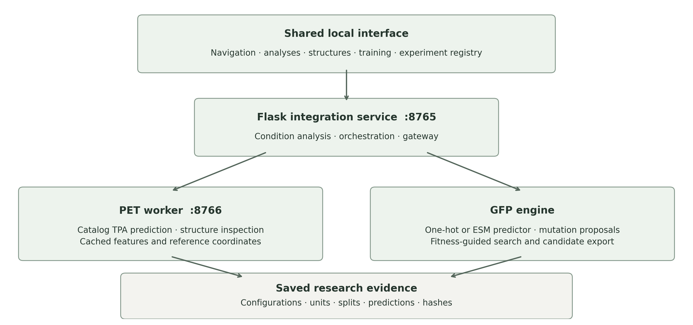
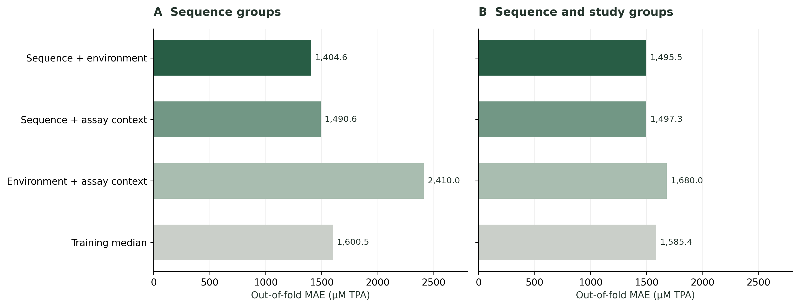
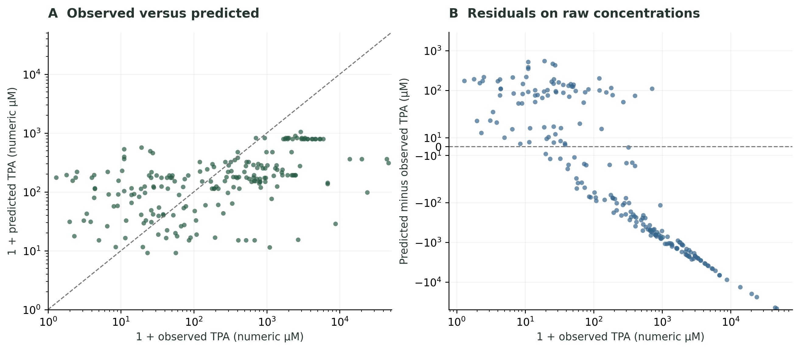

# EnzAIme Helix: A Reproducible Platform for Environmental Analysis and Protein Directed Evolution

Project summary and manuscript basis

Evidence snapshot 25–26 October 2026; prepared 26 October 2026

This document describes the completed local software, saved computational experiments and their scientific limits. It provides material for drafting a journal manuscript and a reproducible demonstration. The project is an integrated research prototype with exploratory evaluation. Its current evidence does not establish high prediction accuracy, improved biological activity or superiority to the base paper. The strongest supported contribution is reproducible integration of protein workflows with explicit provenance and controlled comparisons.

## 1 Abstract suitable for a manuscript draft

Protein engineering workflows often separate sequence design, assay-condition analysis, structural inspection and experiment tracking. We developed EnzAIme Helix, a local research platform that integrates a PET-enzyme discovery application with an avGFP directed-evolution workflow adapted from a published language-model-guided method. The platform combines protein representations, temperature, pH and reaction duration with interactive condition analysis, sequence-matched structural views and persistent experiment records. The PET dataset contains 221 source assay records, of which 208 measurements spanning 25 sequence groups are eligible for modeling. A subsequent assay-context study evaluates 24 predefined configurations using nested sequence-grouped and sequence-and-study-grouped validation. In the earlier condition study, sequence-plus-environment features achieved a grouped mean absolute error of 1325.3 µM, compared with 1589.9 µM for sequence-only features, while R² remained negative. In the later assay study, sequence-plus-environment selection produced a grouped mean absolute error of 1404.6 µM and R² of −0.051; stricter sequence-and-study grouping yielded 1495.5 µM and −0.073. An avGFP one-hot Ridge baseline evaluated on 400 held-out sequences achieved a mean absolute error of 0.534 and Spearman correlation of 0.805. Structural image fusion did not establish an improvement, and the independent evaluator required for comparison with the base paper remains unavailable locally. The platform supports traceable computational investigation while exposing limitations associated with sparse proteins, heterogeneous assays and surrogate-based sequence search.

Keywords: protein engineering; directed evolution; PET hydrolase; protein language model; assay conditions; reproducibility; grouped validation.

## 2 Research problem and project objectives

The project addresses a practical research workflow: inspect protein evidence, rank catalog enzymes under specified assay conditions, examine structural representations, generate GFP sequence proposals and retain the information required to reproduce each result. The software serves two scientific tasks. PET modeling predicts terephthalic acid (TPA) concentration in micromolar units. GFP modeling predicts fitness on the supplied avGFP dataset scale and uses that predictor to guide sequence search. No shared cross-task model or transfer-learning result has been established.

The implementation objectives were to integrate both downloaded projects in one local interface; expose temperature, pH and time sensitivity; recover useful structure-image functionality; train controlled PET comparisons; retain experiment configurations and fingerprints; and make the application straightforward to run from VS Code. These engineering objectives are implemented. The research objectives of accurate unseen-protein prediction, a fully matched paper reproduction and demonstrated algorithmic novelty remain open.

The environmental analysis in this project concerns biochemical assay conditions. It does not estimate carbon emissions, environmental toxicity, life-cycle impact, field degradation rates or verified plastic removal. TPA concentration alone is not a universal degradation efficiency: assay volume, substrate loading, enzyme amount, material form and duration affect its interpretation.

## 3 Relationship to the two projects and the base paper

EnzAIme_ML contributes PET catalog data, cached ESM-2 features, an existing Attention1D activity checkpoint, condition inputs, mutation preview, residue sensitivity, PDB inspection, structure matching and measured stability evidence. Enzyme_ML_new contributes the downloaded directed-evolution source, an avGFP baseline, a local ESM adaptation, experiment persistence and the integration layer. The source folders remain linked on this computer; the application is not currently a standalone portable copy of both projects.

The base paper by Tran and Hy [1] presents language-model-guided mutation proposals and masking within directed evolution. Its experiments use distinct optimization and evaluation oracles. The authors' official repository [2] supplies the source basis. The local adaptation uses smaller models/settings and currently exposes avGFP. The original independent evaluation checkpoint is not installed, so a local search score cannot reproduce the paper's result tables.

| Aspect | Base paper or original component | Current integrated project |
|---|---|---|
| Scientific tasks | Eight directed-evolution benchmarks in the paper | avGFP search plus a separate PET assay workflow |
| Protein representations | ESM-based protein encoders | Frozen ESM-2 features and task-specific predictors |
| Mutation model | Paper uses ESM-2 35M | Local choice of cached 8M or 35M model |
| Optimization encoder | Paper specifies a 33-layer ESM-2 encoder | Smaller encoder selected for local experiments |
| Search settings | Population 128; four proposals per member; five repeats | Configurable local budget; two ESM proposals per member; one seed per run |
| Starting sequence | Paper's wild-type starting sequence | Median-fitness training sequence in the local adaptation |
| PET environmental inputs | Already present in EnzAIme_ML | Extended with surfaces, sensitivity curves and scenario ranking |
| Structural images | Existing matched structures in the PET project | Five reproducible views plus provenance and exports |
| User interface | Separate project interfaces | Shared navigation with retained module state and transitions |
| Evidence management | Original project artifacts | Shared registry, explicit units, fingerprints and downloads |

## 4 Completed application modules

The shared workspace runs at http://127.0.0.1:8765/. It presents one persistent navigation shell and preserves loaded module state when users change sections. Transitions respect reduced-motion preferences. Separate runtime processes preserve the existing dependencies of each project; the user starts them with one launcher.

| Module | Implemented behavior | Main scientific qualification |
|---|---|---|
| Enzyme discovery | Rank 25 catalog proteins at selected temperature, pH and duration; retain recommendations | Predicts catalog TPA, not validated mutant effects |
| Environmental analysis | Condition windows, 27-point scenario ranking, 7 by 7 response surface and three 13-point sweeps | Sensitivity of a fitted model, not causal evidence |
| Protein images | Three backbone projections, a distance map, a proximity map and downloadable bundle | Renders existing predicted coordinates |
| Sequence and structure | FASTA import/export, substitution checks, one-click reference mapping, rotatable view and reference PDB export | Coordinates remain those of the reference; no mutant fold is predicted |
| Directed evolution | One-hot Ridge baseline and ESM-guided sequence proposals with elitist selection | Optimized candidate scores come from the search predictor |
| Uncertainty and diversity option | Three bootstrap decoder heads and a diversity term in candidate selection | Ensemble spread is uncalibrated |
| Training laboratory | Latest training progress, feature coverage, grouped errors and prediction plot | Full-data refit is an experimental artifact |
| Model comparison | Fixed historical test and grouped comparisons with preserved cohorts and units | Scores from different protocols cannot be pooled |
| Experiment registry | Persistent PET, condition-analysis and avGFP records with exports | Software provenance supports traceability, not biological validity |

The original PET activity checkpoint remains the default predictor. The separate condition-image surrogate is available as an experimental option, and the later assay study is displayed for inspection. Training completion does not automatically promote a newly fitted checkpoint into the prediction service.

The sequence workflow accepts a single protein FASTA and compares its letters with the selected reference. For equal-length sequences with at most 20 substitutions, it recovers one-based mutation notation and validates the edits through the existing API. Multiple records, ambiguous residues, gaps, unsupported lengths and excessive differences produce explicit errors. The example S121E/D186H/R280A imports as a 290-residue IsPETase variant. Selecting “Inspect edits on reference structure” loads the sequence-matched reference coordinates and highlights S121; separate buttons inspect D186 and R280. The reference residues retain their original identities. A distinct PDB download exports those unchanged reference coordinates. FASTA is a sequence exchange format and cannot provide a three-dimensional fold by itself; mutant structure prediction is not implemented.

Measured stability evidence and training/import code are present in the PET project. Its data manifest records 5622 Tm measurements across 660 sequence entries. The live service reports that a compatible stability checkpoint is unavailable, so validated joint activity-stability optimization is not a completed result. Optional local LLM explanations require their own running service/model; numeric scientific predictions do not depend on that text generator.

## 5 Architecture and data flow

The browser communicates with the Flask integration service on port 8765. GFP experiments run in the Helix environment. Allowlisted PET requests are forwarded to an authenticated FastAPI worker on port 8766, which uses the PET environment and existing artifacts. Per-launch request credentials remain local. The launcher starts both processes, waits for readiness and stops its own process tree when the user exits.



Figure 1. The integrated application preserves two scientific tasks and their separate outcomes. Condition analyses use the PET workflow; GFP search uses its own predictor and dataset. Shared storage records provenance without combining scores.

The application stores GFP runs under `runs/`, PET recommendation records under `research_runs/`, environmental analyses under `analysis_runs/`, and generated structural views under `generated_structures/`. Each applicable output records its configuration, target units, dataset/model identifiers and source hashes. Models and their evaluation reports remain under `models/` or in the linked PET project.

## 6 Datasets and preprocessing

| Evidence source | Available data | Use in this project |
|---|---|---|
| PET source table | 221 confirmed assay rows and 25 protein IDs | Source for the condition and assay studies |
| Eligible PET cohort | 208 measurements; 25 exact-sequence groups; 22 study identifiers | Prediction and grouped evaluation |
| Strict PET grouping | 19 connected components linking sequences and studies | Hold out shared sequence/study connections together |
| Matched structures | 13 full-sequence matches; 12 unsupported catalog proteins | Structural inspection and image generation |
| avGFP benchmark | 51715 valid deduplicated sequences | Available benchmark inventory; runs use selected sample budgets |
| Demonstrated avGFP baseline | 2000 sampled sequences; 1600 train and 400 test | Saved CPU baseline experiment |
| Stability evidence | 5622 measurements and 660 sequence entries | Evidence browsing and future model development |

The PET loader excludes nonfinite values, nonpositive duration and negative target values, and removes duplicate records according to sequence, assay values and source-record identifiers. The resulting eligibility rules remove or deduplicate 13 source rows. Cached sequence features must match the reference sequence hashes and contain finite per-residue embeddings. The eligible PET target ranges from 0.3 to 47000 µM, with a median of 234.5 µM. This wide distribution is material to interpretation of raw-unit error metrics.

Exact sequence groups keep repeated measurements for the same sequence together during grouped validation. The later study additionally connects sequence groups with source-study identifiers and holds out whole connected components. This reduces sharing of publication-specific assay patterns across train and evaluation partitions, but does not create a sequence-family split: homologous sequences can still occur in different groups.

The historical PET split contains 172 training observations, 18 validation observations and 18 test observations, corresponding to 15, 5 and 5 exact sequence groups. It has already been inspected during development. Its scores are exploratory historical comparisons, not a fresh final confirmation set.

For avGFP, sequences are deduplicated before a seeded 80/20 split. A random split may place closely related variants on both sides. The saved baseline therefore demonstrates within-dataset prediction under that split, not generalization to distant sequence families.

## 7 Modeling and analysis methods

### 7.1 PET prediction and condition features

The existing PET model combines frozen ESM-2 35M residue representations, an Attention1D prediction head and standardized temperature, pH and reaction time. Its target is log(1 + TPA), with outputs expressed in µM. The served checkpoint declares `image_trained=false`; structural images are not learned inputs to that checkpoint.

The condition study uses mean-pooled cached ESM embeddings, training-only standardization and up to five principal components. Environmental descriptors include temperature, pH, log(1 + hours), squared distance from pH 7, reciprocal absolute temperature and a temperature-duration interaction. Candidate regressors include regularized linear and tree methods. These descriptors are fixed numerical features; they are not kinetic laws.

The later assay study extracts only whitelisted structured pre-assay fields. It adds enzyme concentration in preserved unit categories, substrate concentration, reaction volume, PET crystallinity, agitation, material form, preparation category and missingness indicators. Free-text outcomes, target measurements, protein names and DOI values are not predictive features. DOI is used only to define study groups. Missing or conflicting context stays missing.

This later study evaluates 24 predefined configurations: three input sets and eight regressor settings. Models include Ridge, ExtraTrees, histogram gradient boosting, kernel Ridge and a three-seed small neural ensemble. Sequence-plus-environment and sequence-plus-context models use training-fitted sequence standardization and up to eight principal components. Imputation and feature scaling are fitted within each training fold. The selection objective is mean absolute log1p error averaged equally across sequence groups, reducing the influence of proteins with many repeated assays.

Each of the two evaluation designs uses five outer folds and three inner folds. Model choice is made separately within each outer training partition. Out-of-fold scores therefore summarize a model-selection procedure, not the performance of one fixed ExtraTrees checkpoint. The final research model was selected using pooled inner-validation losses and refit on all 208 observations. Its saved recipe is sequence-plus-environment ExtraTrees with 240 trees, minimum leaf size 2, maximum feature fraction 0.85 and seed 42. The refit has no unseen test observations and has not replaced the default service model.

### 7.2 Environmental scenario analysis

For a selected central temperature, pH and duration, the software constructs a discrete condition window with up to three values per axis. A nondegenerate window produces 27 scenarios. Catalog proteins are ranked using the tenth percentile of predicted TPA across those scenarios. The UI also supplies a 7 by 7 temperature-pH surface at fixed duration and 13-point one-variable sweeps. Observed assays are shown separately so users can compare model behavior with measured evidence.

The tenth-percentile score is a lower-tail scenario summary. It is not a calibrated confidence bound, a statistical guarantee or a measured activity. The scenario standard deviation describes variation across user-chosen conditions. It is not predictive uncertainty. The most favorable grid point is a candidate condition for further investigation, not an experimentally proven optimum.

### 7.3 Structural representations

The generator requires a complete sequence match to a chain in an existing cached AlphaFold-predicted PDB structure. It uses the first model, resolves alternate atoms by occupancy and checks coordinates. It draws three C-alpha backbone projections using principal coordinate planes and colors residues by sequence order. Gaps above the joining threshold are not connected. A distance image encodes pairwise C-alpha distances capped at 20 Å, with brighter pixels representing closer residues. A second image marks C-alpha pairs within 8 Å, including local and diagonal proximity. It is not an atom-level contact predictor.

Each bundle contains `front.svg`, `side.svg`, `top.svg`, `distance.png`, `contacts.png` and a JSON manifest recording protein/sequence identity, the source structure, representation and file hashes. These deterministic images are visual representations of supplied coordinates. They do not establish a new fold, a mutant structure, molecular dynamics or an independent biological label. Missing structures remain unsupported.

The condition-image experiment used an 8 by 8 block-averaged distance-map descriptor plus an availability indicator. It did not train the original neural image branch or a new structural CNN. The experiment did not establish an image benefit. Matched-structure subsets and shuffled-image controls are still needed before claiming that geometry improves prediction independently of protein identity or coverage.

### 7.4 GFP directed evolution

The CPU baseline fits position-specific one-hot features with Ridge regression, creates amino-acid substitutions and retains high-scoring candidates by elitist selection. The ESM workflow freezes the protein encoder, trains a task-specific Attention1D head and proposes replacements using masked-language-model outputs. Only canonical amino acids are proposed. The local settings differ from the paper in encoder size, initialization, proposal budget, population size and masking proportions.

The optional comparator trains three bootstrap heads and uses predicted mean plus 0.5 times ensemble standard deviation, with a 0.5-scaled normalized Hamming-distance contribution during selection. This is an implemented heuristic with uncalibrated spread. Its current small demonstrations do not establish superiority, calibrated uncertainty or a novel acquisition method. Generated candidate fitness is evaluated by the predictor being optimized, so a rise in search score can reflect model exploitation and requires an independent evaluator.

### 7.5 Evaluation measures

MAE is the mean absolute prediction error; RMSE penalizes larger errors more strongly. PET errors use µM and GFP errors use dataset fitness units. R² compares squared error with a constant held-out-mean reference; a negative value means larger squared error than that reference. Spearman correlation measures rank association. Neither R² nor Spearman is a classification-accuracy percentage.

The assay report also records median and 90th-percentile absolute error, log1p RMSE and a shifted twofold criterion. That criterion requires `(1 + predicted TPA) / (1 + observed TPA)` to lie between 0.5 and 2, using numeric µM values. It compares 1 + TPA, not raw concentration. The distinction matters near zero and is retained explicitly in the tables.

## 8 Recorded results

### 8.1 Historical PET comparison

These methods share the 18-row historical test cohort. The selected model in each feature group follows its recorded validation protocol. The environment-only comparison is an exploratory ablation and cannot distinguish catalog proteins at identical conditions.

| Method | MAE µM | RMSE µM | R² |
|---|---:|---:|---:|
| Original PET neural checkpoint | 46.7844 | 53.4576 | −2.2965 |
| Environment-only ablation | 38.4906 | 47.2158 | −1.5716 |
| Sequence plus environment | 141.4538 | 154.7579 | −26.6270 |
| Sequence plus environment plus image descriptor | 99.1337 | 111.3755 | −13.3089 |

The environment-only MAE is 17.7% below the original checkpoint on this particular historical cohort. All displayed R² values are negative, the cohort is small, and its repeated use limits confirmation claims. The image model performs worse than the original checkpoint. No paper-superiority or biological improvement claim follows.

### 8.2 Earlier condition study with sequence groups

| Input set | MAE µM | RMSE µM | R² | Spearman |
|---|---:|---:|---:|---:|
| Sequence only | 1589.94 | 5325.19 | −0.0875 | −0.3627 |
| Environment only | 1546.22 | 5291.59 | −0.0738 | 0.2152 |
| Sequence plus environment | 1325.30 | 5219.30 | −0.0447 | 0.4792 |
| Sequence plus environment plus image descriptor | 1540.18 | 5301.51 | −0.0779 | −0.0325 |

The sequence-plus-environment MAE is 16.6% lower than sequence-only on the same outer-fold observations. This supports investigating condition features in this dataset. It does not establish a reliable improvement outside this dataset, and the result has no reported independent confidence interval. These pooled 208-row errors must not be compared numerically with the 18-row historical cohort as if they shared a target distribution.

### 8.3 Later assay-context study

| Evaluation and input set | MAE µM | RMSE µM | R² | Spearman |
|---|---:|---:|---:|---:|
| Sequence groups; sequence plus environment | 1404.64 | 5234.19 | −0.0507 | 0.5303 |
| Sequence groups; sequence plus assay context | 1490.61 | 5261.19 | −0.0615 | 0.3128 |
| Sequence groups; training-median baseline | 1600.46 | 5278.91 | −0.0687 | −0.6113 |
| Sequence and study groups; sequence plus environment | 1495.47 | 5289.35 | −0.0729 | 0.3195 |
| Sequence and study groups; sequence plus assay context | 1497.28 | 5298.64 | −0.0767 | 0.2632 |
| Sequence and study groups; training-median baseline | 1585.40 | 5287.31 | −0.0721 | −0.4944 |

For sequence-plus-environment selection, the median absolute error is 183.93 µM and the 90th-percentile absolute error is 2432.67 µM under sequence grouping. The shifted twofold fraction is 22.1%; it decreases to 16.8% under sequence-and-study grouping. These outcomes do not constitute high accuracy or consistently small deviation. The final refit selecting a simpler input set also means assay-context additions did not establish an improvement under the recorded selection objective.



Figure 2. Pooled out-of-fold MAE for the assay study, with identical observations within each evaluation design. Model selection occurs inside outer training folds. Lower error is preferable. No error bars are shown because repeated-seed or independent-sample uncertainty intervals were not established.



Figure 3. Saved sequence-grouped predictions from the assay study. The scatter uses a logarithmic display of 1 + TPA to reveal the wide dynamic range; the dashed line indicates agreement. The residual panel shows raw prediction minus observation. These plots display predictive failures as well as apparent agreement.

### 8.4 GFP experiments

| Saved experiment | Training and test budget | MAE | RMSE | Spearman |
|---|---|---:|---:|---:|
| One-hot Ridge baseline | 1600 train; 400 test; seed 42 | 0.5340 | 0.6410 | 0.8052 |
| ESM single-head execution demonstration | 80 train; 20 test; one epoch | 1.156 | 1.515 | −0.017 |
| ESM uncertainty-diversity execution demonstration | 80 train; 20 test; three heads | 1.186 | 1.397 | 0.364 |

The Ridge baseline completed ten search rounds and exported 16 candidates. Its result is from one random split of a 2000-sequence sample. The small ESM runs demonstrate that real model loading, training and sequence proposal execute and save outputs; they are not comparable performance experiments because budgets/seeds differ and the held-out samples are tiny. The full 51715-sequence benchmark has not been exhaustively trained and evaluated in the saved demonstrations. Freezing a pretrained language model also differs from training all of its parameters.

### 8.5 Comparison with published MLDE scores

The supplied paper reports avGFP maximum fitness 9.50 ± 0.37 in Table II and average fitness 9.33 ± 0.40 in Table V, on printed pages 423–424 [1]. These are design scores under its evaluation protocol. The local application lacks the same independent evaluator and uses adapted settings. PET concentration errors and local GFP predictor errors are different outcomes. The current project therefore has no valid quantitative claim to outperform those paper scores.

## 9 Contribution and journal positioning

The defensible contribution statement is: “We implement and evaluate an integrated local platform that connects condition-dependent PET ranking, structural representations, avGFP sequence search and reproducible experiment records, and we report the limits revealed by grouped evaluation.” The completed contribution is strongest as research software and an exploratory computational case study. Whether that scope is sufficient depends on the target journal and the authors' additional experiments.

The current extensions include condition-window ranking, linked response surfaces and measured evidence, verified-coordinate image bundles, an assay-context ablation study, sequence/study grouping and provenance-preserving integration. Environmental model inputs already existed in the PET project. Visualizing conditions, combining known features, displaying protein structures and integrating interfaces do not on their own establish a new scientific algorithm.

Related work narrows the novelty claim. Protein language models and ESM features have established precedent [3]. ALDE studies uncertainty-guided experimental selection [4], while MODIFY explicitly combines fitness and diversity for library design [5]. The current uncertainty/diversity heuristic consequently needs a focused literature comparison and controlled evidence of a distinct contribution before being called novel. This brief positioning is not a systematic literature review.

## 10 Limitations and required evidence before stronger claims

The PET dataset is small in independent sequence diversity despite having 208 rows. Assay protocols and responses are heterogeneous, context fields are incompletely recorded, and the target has extreme values. Exact-sequence grouping does not prevent homology leakage. Sequence/study grouping is stricter, but a genuinely new external assay set would provide stronger evidence. Current negative R² and large tail errors preclude describing the model as highly accurate.

The historical test has already informed development. The current reports do not provide repeated-seed confidence intervals, a calibrated uncertainty model or prospective validation. The final all-data refit has no independent holdout. Higher training effort cannot replace missing independent data, and no training-fit metric should be reported as a test score.

The image branch of the default PET neural checkpoint is untrained; structural coverage is incomplete; the separately trained descriptor model did not improve the historical test. The generated images are not novel structural predictions. Mutation preview and GFP candidates require independent validation before any activity, stability or environmental-efficacy claim.

Before a paper claiming scientific improvement is submitted, the priority experiments are: obtain an untouched external PET cohort or a prespecified family/study split; compare strong simple and neural baselines under the same budgets; repeat relevant runs and quantify uncertainty at the independent-group level; test context and image contributions with matched controls; recover and validate the original paper evaluator if claiming replication; and independently evaluate selected candidates. Laboratory validation is needed for claims of experimentally improved enzymes or plastic degradation.

Author names, affiliations, contributions, funding, conflicts of interest, target-journal formatting and final data/code availability statements must be completed by the authors. Cite and comply with upstream code/data licenses. The downloaded directed-evolution source is GPL-3.0; the linked PET project and third-party assets require their own attribution review before redistribution. No journal acceptance, novelty determination or ethics approval is implied by this draft.

## 11 Software verification and reproducibility record

On 25–26 October 2026, the full Python suite passed 24 tests. The checks independently recompute MAE, RMSE, R² and the shifted twofold statistic; verify source/model fingerprints; check that each observation appears once in outer evaluation; enforce sequence/study separation within nested folds; confirm shell and embedded routes; and reject FASTA sent to coordinate inspection before forwarding it to the worker. Six JavaScript sequence-file tests also passed, as did the frontend production build and lint. These checks establish software contracts, not biological validity.

A real-browser check completed ten workflow assertions without JavaScript errors: variant export, FASTA reimport, all three example residue mappings, reference PDB identity, state retention, actionable file-format errors, rejection of renamed FASTA, canvas controls and synchronized navigation. Evidence is saved in `reports/sequence_workflow_verification.json`, with screenshots of the imported variant and reference viewer. A separate browser check covers the nine principal workspace routes and preservation of generated images when navigating.

Live integration checks also passed for the loaded PET checkpoint, real recommendations, saved-record round trips, complete sequence-to-structure mapping, residue attribution, mutation preview and a registry containing all three record domains. Live analysis checks returned 27 scenarios, 49 response cells, three 13-point sweeps, all 25 catalog proteins and five downloadable structural images. ZIP/image hashes matched their manifests. Evidence is saved in `reports/integration_verification.json` and `reports/analysis_verification.json`.

Core traceability sources are `models/condition_analysis/report.json`, its protocol and predictions; `models/assay_v2/train-20261024-160717/report.json`, its nested splits and out-of-fold predictions; the PET `models/neural/manifest.json`; and GFP run `20261023-162906-a42ad8`. The journal package includes machine-readable metric tables and a file-hash manifest. Preserve the original reports if rerunning studies for a manuscript revision.

## 12 Run commands and project handover

Open `D:\Enzyme_ML_new` in VS Code, choose Terminal → New Terminal, and run:

```powershell
Set-Location D:\Enzyme_ML_new
.\Check-Research.cmd
.\Start-Research.cmd
```

Wait for the ready message, then open http://127.0.0.1:8765/. Keep the terminal open and use Ctrl+C to stop the launcher. If another project copy is already running, stop it first. The alternative VS Code workflow is Terminal → Run Task → Start integrated EnzAIme + Helix. The supplied `EnzAIme-Helix.code-workspace` opens both source folders in one editor window.

Both `D:\Enzyme_ML_new` and `D:\Final_Year_Project\EnzAIme_ML` are required. The launcher uses `.venv` for Helix and `.venv-1` for PET. The maintained React source and production build now live in `Enzyme_ML_new/frontend/`; they were copied from the linked project and extended locally. The original PET backend, data, features and models remain linked. No environment activation or separate npm command is needed for this installed build. Optional model downloads and explanations have additional runtime requirements. A full fresh-machine recreation requires both projects and their artifacts; the linked installation has not been verified as a standalone portable release.

The detailed guide `docs/RUN_IN_VS_CODE.md` covers troubleshooting, folder relocation, retraining, verification and files to preserve. The complete local source remains in the two project directories. This journal package is documentation and evidence, not a substitute for those source/model/data folders.

## 13 Conclusion suitable for a manuscript draft

EnzAIme Helix provides an integrated local workflow for condition-dependent PET ranking, structural inspection and avGFP sequence search, supported by persistent experiments and explicit provenance. The reported studies suggest that assay-condition information deserves further investigation, while revealing weak prediction on unseen PET sequence/study groups and no established structural-image benefit. The work demonstrates a reproducible research implementation and identifies data and evaluation requirements for stronger predictive claims. Independent candidate assessment and a matched paper protocol remain necessary before claiming improved protein function or superiority to prior methods.

## References

[1] T. V. T. Tran and T. S. Hy. Protein Design by Directed Evolution Guided by Large Language Models. IEEE Transactions on Evolutionary Computation, 29(2), 418–428, 2025. DOI: https://doi.org/10.1109/TEVC.2024.3439690. Paper tables and settings checked against the supplied PDF.

[2] HySonLab. Directed_Evolution, official implementation repository. https://github.com/HySonLab/Directed_Evolution. The project uses the downloaded local source and records its own adaptations. Repository inspected 25 October 2026.

[3] Z. Lin et al. Evolutionary-scale prediction of atomic-level protein structure with a language model. Science, 379(6637), 1123–1130, 2023. DOI: https://doi.org/10.1126/science.ade2574. Model documentation and citation: https://github.com/facebookresearch/esm.

[4] J. Yang et al. Active learning-assisted directed evolution. Nature Communications, 16, 714, 2025. DOI: https://doi.org/10.1038/s41467-025-55987-8. Author-hosted source: https://authors.library.caltech.edu/records/c7t9c-bp526.

[5] K. Ding et al. Machine learning-guided co-optimization of fitness and diversity facilitates combinatorial library design in enzyme engineering. Nature Communications, 15, 6392, 2024. DOI: https://doi.org/10.1038/s41467-024-50698-y. Public manuscript: https://par.nsf.gov/servlets/purl/10529357.

Additional references are needed for the underlying avGFP measurements, each PET source study, cached structure resources, stability measurements and any newly added experiments. The project manifests and source records retain the relevant provenance. The authors should verify and include those study-level citations before submission.
